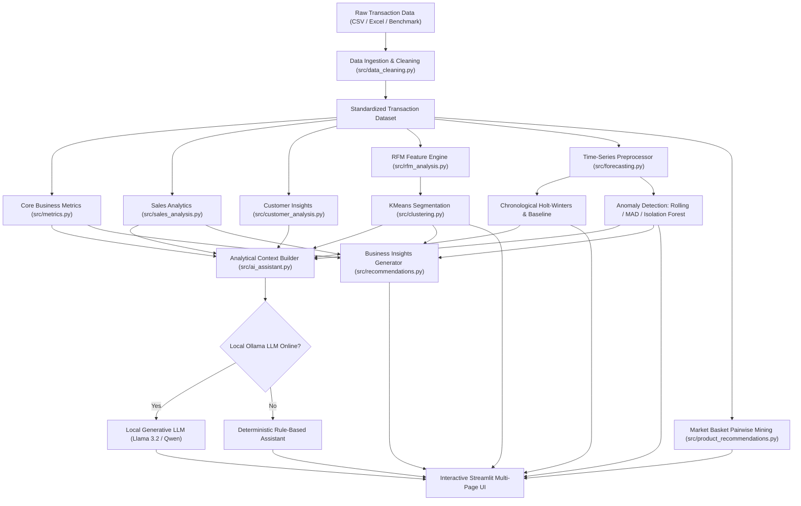

# AI-Powered E-Commerce Sales and Customer Insights Dashboard

[](https://www.python.org/)
[](https://streamlit.io/)
[](LICENSE)
[]()

> **Final-Year Academic Data Science & Machine Learning Capstone Project**  
> An enterprise-grade commercial intelligence application integrating statistical data engineering, time-series forecasting, unsupervised KMeans customer clustering, association rule mining, anomaly detection, and a privacy-preserving local AI assistant.

---

## 📌 Table of Contents
1. [Abstract](#-abstract)
2. [Problem Statement & Objectives](#-problem-statement--objectives)
3. [Key Features](#-key-features)
4. [System Architecture](#-system-architecture)
5. [Technology Stack](#-technology-stack)
6. [Dataset & Schema](#-dataset--schema)
7. [Installation & Setup](#-installation--setup)
8. [Local AI Setup (Optional Ollama)](#-local-ai-setup-optional-ollama)
9. [Running the Application](#-running-the-application)
10. [Automated Testing](#-automated-testing)
11. [Page Breakdown](#-page-breakdown)
12. [Methodology & Evaluation](#-methodology--evaluation)
13. [Academic Viva & Defense Guide](#-academic-viva--defense-guide)
14. [Limitations & Future Scope](#-limitations--future-scope)
15. [License](#-license)

---

## 📄 Abstract

Modern e-commerce enterprises generate voluminous transactional streams, yet non-technical decision-makers routinely struggle to synthesize raw tables into operational clarity. This project presents the **AI-Powered E-Commerce Sales and Customer Insights Dashboard**, a fully functional, reproducible, and explainable commercial analytics platform. Built strictly using open-source, free-tier technologies, the platform combines:
- Real transaction data engineering (cancellation/refund identification, duplicate pruning, and fuzzy schema harmonization).
- Chronologically cross-validated time-series sales forecasting (Holt-Winters Exponential Smoothing with expanding uncertainty cones).
- RFM (Recency, Frequency, Monetary) feature extraction with Scikit-Learn KMeans clustering and heuristic cluster labeling.
- Pairwise Market Basket Analysis calculating Support, Confidence, and Lift for cross-sell recommendations.
- Tri-method anomaly detection (Rolling variance, Robust MAD z-scores, and Isolation Forests).
- A dual-engine sales assistant operating locally over Ollama (e.g., Llama 3.2 or Qwen 2.5) with zero cloud data transmission, supported by a deterministic rule-based fallback when offline.

---

## 🎯 Problem Statement & Objectives

### Problem Statement
E-commerce businesses frequently suffer from data silos where commercial reporting relies on static spreadsheets, lagging KPIs, and opaque third-party cloud analytics that compromise customer privacy. Small and mid-market organizations lack the budget for costly enterprise licenses or paid LLM tokens, necessitating an offline-first, explainable, and cost-free decision-support platform.

### Objectives
1. **Data Integrity:** Ingest public transactional datasets (such as the UCI Online Retail benchmark) and custom uploads with automatic schema validation and returns handling.
2. **Predictive Analytics:** Implement sales forecasting utilizing strict chronological train/test splits that prevent temporal data leakage.
3. **Customer Segmentation:** Cluster buyers into actionable commercial cohorts (High-Value Champions, Loyalists, At-Risk) using mathematical RFM transformations.
4. **Product Affinity:** Mine frequent itemset associations to uncover actionable cross-selling affinities.
5. **Operational Monitoring:** Detect revenue spikes and inventory stockouts via robust anomaly algorithms.
6. **Local Conversational AI:** Build an opt-in natural language sales assistant that communicates with local open-weight models via Ollama without leaking transaction records or PII.

---

## 🌟 Key Features

- **Executive Commercial Command Center:** Dynamic KPIs (Gross Revenue, Net Sales, Refunds, AOV, Repeat Rate, Cancellation Rate) and period-over-period delta shifts.
- **Granular Product & Regional Intelligence:** Best/worst performing SKUs, international revenue shares, and 24-hour / day-of-week demand heatmaps.
- **RFM Customer Clustering:** Log-normalized RFM vectors, StandardScaler, Scikit-Learn KMeans, silhouette score optimization, and interactive 3D/2D scatter plots.
- **Chronological Time-Series Forecasting:** Evaluates candidate Exponential Smoothing against a rolling naive baseline; reports MAE, RMSE, MAPE, and 80%/95% prediction intervals.
- **Market Basket Recommendation Engine:** Transparent association rules calculating Support, Confidence, and Lift with targeted SKU cross-sell search.
- **Tri-Method Anomaly Detection:** Rolling 7-day variance envelope, Robust Median Absolute Deviation (MAD), and unsupervised Isolation Forests.
- **Dual-Engine Sales Assistant:** Privacy-guaranteed local Ollama LLM integration (`llama3.2:1b`, `qwen2.5:1.5b`) with an instant deterministic rule-based fallback when offline.
- **Strategic Action Generator:** Automated decision matrix diagnosing revenue momentum, SKU concentration risks, churn urgency, and cross-border expansion.
- **Data Engineering Explorer:** Complete audit trail of raw vs sanitized records with CSV export.

---

## 🏛️ System Architecture



---

## 💻 Technology Stack

| Component | Technology | Rationale / License |
| :--- | :--- | :--- |
| **Language** | Python 3.11 / 3.12 | Industry standard for Data Science and ML |
| **Frontend UI** | Streamlit (>= 1.36.0) | Reactive, Python-native dashboard framework |
| **Data Manipulation** | Pandas, NumPy | High-performance vector operations and cleaning |
| **Machine Learning** | Scikit-Learn | KMeans clustering, StandardScaler, Isolation Forest |
| **Time Series** | Statsmodels | Holt-Winters Exponential Smoothing (ETS) |
| **Visualizations** | Plotly Express & Graph Objects | Hardware-accelerated, responsive web charts |
| **Local AI Runtime** | Ollama (Local HTTP API) | 100% free, offline, privacy-safe LLM runtime |
| **Testing** | Pytest | Automated test runner with zero mock leakage |
| **Export Formats** | CSV / OpenPyXL | Standardized business artifact exports |

---

## 📊 Dataset & Schema

The dashboard supports the public **UCI Online Retail Dataset** and any custom e-commerce transaction export containing similar transactional attributes.

### Standardized Attributes
- `InvoiceNo`: 6-digit transaction identifier. Prefixed with `'C'` for cancelled/refund orders.
- `StockCode`: Product SKU identifier.
- `Description`: Item title/name.
- `Quantity`: Units per line item (negative for returns).
- `InvoiceDate`: Purchase timestamp (`YYYY-MM-DD HH:MM:SS`).
- `UnitPrice`: Product price in currency units.
- `CustomerID`: Unique 5-digit buyer identifier (supports null for guest checkout).
- `Country`: Geographical destination of transaction.

### Derived Metrics
- `NetRevenue = Quantity * UnitPrice` (signed transaction value).
- `GrossRevenue`: Positive line totals (`Quantity > 0`).
- `RefundAmount`: Absolute value of negative items (`Quantity < 0`).
- `IsCancelled`: Boolean flag for return/cancellation auditing.

---

## ⚙️ Installation & Setup

### Prerequisites
- Python 3.11 or 3.12 installed on your system.
- Git installed.

### Step 1: Clone the Repository
```bash
git clone https://github.com/shubhamm8/ecommerce-sales-customer-insights-dashboard.git
cd ecommerce-sales-customer-insights-dashboard
```

### Step 2: Create and Activate Virtual Environment

**Windows (PowerShell):**
```powershell
python -m venv .venv
.\.venv\Scripts\Activate.ps1
```

**Windows (Command Prompt):**
```cmd
python -m venv .venv
.\.venv\Scripts\activate.bat
```

**Linux / macOS:**
```bash
python3 -m venv .venv
source .venv/bin/activate
```

### Step 3: Install Required Dependencies
```bash
pip install --upgrade pip
pip install -r requirements.txt
```

---

## 🦙 Local AI Setup (Optional Ollama)

The application functions **100% out of the box** without Ollama by automatically activating its deterministic rule-based assistant. To optionally enable local generative conversational AI:

1. **Download and Install Ollama:**
   - Visit [https://ollama.com/download](https://ollama.com/download) and install for Windows, macOS, or Linux.
2. **Start the Ollama Server:**
   ```bash
   ollama serve
   ```
3. **Pull a Compact Open-Weight Model (Recommended):**
   ```bash
   # Ultra-fast, lightweight 1B model (ideal for 8GB RAM laptops)
   ollama pull llama3.2:1b

   # Alternative compact model
   ollama pull qwen2.5:1.5b
   ```
4. **Hardware Requirements for Local LLMs:**
   - Minimum: 8 GB System RAM (for 1B/1.5B models).
   - Recommended: 16 GB System RAM or an NVIDIA RTX GPU (for 3B/7B models).
   - Storage: ~1.5 GB disk space for `llama3.2:1b`.

---

## 🚀 Running the Application

Launch the Streamlit web dashboard:
```bash
streamlit run app.py
```
Open your web browser and navigate to `http://localhost:8501`.

---

## 🧪 Automated Testing

The project includes **28 comprehensive automated unit and integration tests** verifying all mathematical engines, data cleaning pipelines, ML models, and API fallbacks.

Run the test suite:
```bash
pytest -v
```

### Verified Test Coverage
- `test_data_cleaning.py`: Alias mapping, duplicate suppression, cancellations flagging, zero-price filtering.
- `test_metrics.py`: Net vs gross revenue, order deduplication, AOV, repeat rate, period-over-period delta.
- `test_rfm.py`: Reference date recency decay, frequency counting, monetary return adjustments.
- `test_clustering.py`: Log1p scaling, StandardScaler variance normalization, KMeans reproducibility, silhouette score.
- `test_forecasting.py`: Chronological train/test separation (zero leakage), MAE/RMSE/MAPE, prediction intervals.
- `test_anomalies.py`: Rolling variance envelopes, robust MAD z-scores, Isolation Forest flags.
- `test_recommendations.py`: Support/Confidence/Lift mining, product cross-sells, business insights generator, local LLM mock integration.

---

## 📱 Page Breakdown

| Page | Title | Functionality |
| :--- | :--- | :--- |
| **0** | `app.py` | Platform homepage, file uploader, session manager, and global navigation. |
| **1** | `1_Executive_Overview.py` | C-level KPI cards, sales trajectory chart, and geographic split. |
| **2** | `2_Sales_Analytics.py` | Best/worst performing SKUs, regional tables, and 24-hour demand heatmaps. |
| **3** | `3_Customer_Insights.py` | Customer lifetime spend, Pareto 80/20 concentration, and search directory. |
| **4** | `4_AI_Sales_Assistant.py` | Conversational assistant with Ollama LLM toggle, evidence inspector, and reset. |
| **5** | `5_Sales_Forecasting.py` | Chronologically split Holt-Winters time-series with 95% confidence bands. |
| **6** | `6_Customer_Segmentation.py` | RFM feature extraction, KMeans clustering, 3D/2D scatter plots, and CSV export. |
| **7** | `7_Product_Recommendations.py` | Market Basket Analysis association rules (Support, Confidence, Lift). |
| **8** | `8_Anomaly_Detection.py` | Rolling variance, robust MAD, and Isolation Forest timeline anomaly detector. |
| **9** | `9_Data_Explorer.py` | Raw vs sanitized dataset comparison, schema validator, and cleaned CSV export. |
| **10** | `10_Business_Insights.py` | Automated 7-dimension strategic recommendation matrix and action plan. |

---

## 🔬 Methodology & Evaluation

Detailed mathematical formulas, data cleaning justifications, and loss metrics are documented in [METHODOLOGY.md](METHODOLOGY.md).

---

## 🎓 Academic Viva & Defense Guide

Key technical highlights to emphasize during viva examinations:
1. **Time-Series Data Leakage Prevention:**
   - *Question:* Why not use standard K-fold cross-validation or `train_test_split(shuffle=True)` for sales forecasting?
   - *Answer:* Randomly shuffling time series introduces future observations into the training set, causing lookahead bias and catastrophic overfitting. We enforce strict chronological splitting (`series.iloc[:-test_size]`).
2. **Skew-Aware RFM Feature Normalization:**
   - *Question:* Why apply `np.log1p()` before running KMeans on RFM data?
   - *Answer:* E-commerce monetary spend and order frequencies follow extreme power-law (Pareto) distributions. KMeans minimizes squared Euclidean distances and is vulnerable to severe skew; log-transformation normalizes feature scales.
3. **Lift Metric in Market Basket Analysis:**
   - *Question:* Why is Confidence alone insufficient for recommending product bundles?
   - *Answer:* If a popular item is purchased in 90% of all transactions, any item paired with it will exhibit 90% confidence by coincidence. Lift divides confidence by baseline support (\(\text{Lift} = \frac{P(B|A)}{P(B)}\)), measuring true association strength above random chance.
4. **Privacy-Preserving Local AI Architecture:**
   - *Question:* How does the AI assistant protect customer privacy?
   - *Answer:* No individual customer records, emails, or invoice lines are transmitted to language models. Only pre-aggregated mathematical summaries are supplied to an offline, open-weight model via Ollama.

---

## ⚠️ Limitations & Future Scope

### Limitations
- **Cost / Margin Data:** Gross margins and true profit cannot be computed without explicit Cost of Goods Sold (COGS).
- **Short Time Series:** Datasets with fewer than 14 contiguous days cannot support robust Holt-Winters seasonal decomposition.
- **Guest Checkouts:** Transactions without a `CustomerID` cannot be integrated into customer-level RFM clustering (though they remain in aggregate financial totals).

### Future Scope
- Implementation of multivariate Prophet or SARIMAX models incorporating promotional calendar regressors.
- Real-time streaming ingestion via Apache Kafka or Webhooks.
- Multi-currency normalization with live forex rate conversion.

---

## 📜 License

This project is licensed under the [MIT License](LICENSE).
